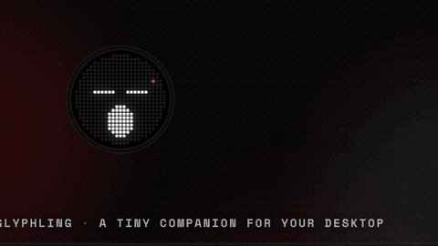

# Glyphling

A tiny animated dot-matrix companion for your Windows desktop and Android. Music visualizer, timer, weather, clock, calendar and system stats, all in one glowing circle.

[](../../releases/latest)


Glyphling is a small LED mascot that lives in a circle on your desktop. It follows your cursor, falls asleep when you leave it alone, and opens a glass panel for the things you glance at all day. It is built with Tauri 2 (Rust backend, web interface), is a few megabytes, and has no account, no telemetry and no background services.

> Glyphling is an independent project and is not affiliated with Nothing. The look is inspired by dot-matrix displays; the app ships its own dot font.

<!-- PROMO: the presentation video/GIF goes here, e.g.  -->

## Contents

- [Download and install](#download-and-install)
- [The circle and its modes](#the-circle-and-its-modes)
- [Interactions](#interactions)
- [Music](#music)
- [Calendar](#calendar)
- [Focus timer, stopwatch and countdown](#focus-timer-stopwatch-and-countdown)
- [Weather](#weather)
- [System, disks and temperature](#system-disks-and-temperature)
- [Placement](#placement)
- [Settings and looks](#settings-and-looks)
- [Updates](#updates)
- [Privacy and network](#privacy-and-network)
- [CPU temperature in detail](#cpu-temperature)
- [Building](#building) and [repository layout](#repository-layout)
- [Credits](#credits)

## Download and install

**Requirements**: Windows 10 or 11 (64-bit) with Microsoft Edge WebView2 (already part of Windows 11; the setup offers to install it if it is missing). No administrator rights are needed to install.

1. Go to the [Releases](../../releases) page and download `Glyphling-Setup-x.y.z.exe`.
2. Run it. It installs for your user in `%LOCALAPPDATA%\Glyphling` (you can choose another folder), adds a Start menu entry and, if you want, a desktop shortcut.
3. Run the same file again later to update in place: settings, themes, events and position are kept. As `uninstall.exe` in the install folder it removes the app (and, if you tick the option, your settings).

The setup is not code-signed yet, so Windows SmartScreen may warn on first launch ("More info" then "Run anyway").

On first run a short tutorial shows the mascot, the dial, the panel, the tray icon and the settings. You can see it again from Settings > Info.

## The circle and its modes

The circle is the whole widget. Out of the box it shows the mascot; choose a mode and a glass panel opens next to it while the circle keeps working as a display.

| Mode | The circle shows | The panel has |
| --- | --- | --- |
| **Mascot** | An animated face that follows the cursor, blinks, smiles when clicked and sleeps when idle | Nothing: it is the resting state |
| **Clock** | Time on the dial, with hands and an outer ring | Time and seconds, date, sunrise and sunset |
| **Calendar** | The day number and a mark for each event | Month view, the events of the selected day, add and delete events |
| **Music** | The cover art, or a visualizer of the real audio spectrum | Title, artist, progress, play/pause, previous, next, volume |
| **Timer** | The remaining time as a ring | Focus, stopwatch and countdown |
| **Weather** | A weather icon | Now, the next hours and the next days |
| **System** | The load of the disks you chose | CPU, RAM, GPU, temperatures and disk usage |

## Interactions

- **Dial**: drag in a circle on the ring, or use the mouse wheel, to pick a mode. Let go and the panel opens. Right-click the circle (or press Esc) to go back to the mascot.
- **Wheel (and arrow keys) inside a mode**: Music changes the volume (1% per step, 5% with Shift); Calendar moves through days; Weather steps through hours and days; System cycles the disks; Timer sets the time of the countdown or of a paused focus phase.
- **Click the circle** while a mode is open: Clock shows or hides the seconds, Music switches between cover and visualizer, Timer starts or stops, Weather, Calendar and System step to the next item.
- **Click the mascot** to make it smile; leave it alone and it falls asleep.
- **Petting**: hold the right button on the circle and rub it back and forth. The mascot closes its eyes, blushes, smiles and sends up little hearts. A plain right click still goes back to the mascot.
- **Dizzy**: move the mouse in circles around the ring and the mascot gets dizzy; keep circling for about three seconds and it throws up (a rare, short egg, with a cooldown).
- **Tickle**: click the mascot six or more times quickly.
- **Yawn and sleep bubble**: poke it while it sleeps and it yawns and wakes up. While it sleeps a bubble grows from its nose: most of the time it pops by itself and wakes it with a start.
- **Daily hello**: the first time you see it each day it greets you (a yawn if it is before 6 am). While music plays and it is awake, its eyes sway to the beat.
- **Drag** the circle where you want it (after enabling "Move the widget" in Settings or the tray menu). It snaps to a 24 px grid, hold Alt to move freely.
- **Tray icon**: left click shows or hides the widget, right click opens the menu (move the widget, window level, settings, quit).

## Music

- Works with any player that talks to Windows media controls: Spotify, Apple Music, YouTube Music in the browser, VLC, foobar2000 and so on.
- Shows title, artist, album, progress and cover art drawn on the LEDs, with a smooth sweep when the track changes. Controls: play/pause, previous, next, seek.
- **Choose the apps it listens to**: in Settings > Music keep a list of the apps you want (add the ones that are running or pick any `.exe`). The widget follows only those, one at a time, and an empty list means any app.
- **Per-app volume**: the circle's volume moves the same slider you see in the Windows volume mixer, only for the apps in your list that have their *Volume* switch on (with an empty list, for the app that is playing). It never changes the system volume.
- **Cover colors**: show the cover in your theme colors, or in its own original colors.
- **Visualizer** from the real audio spectrum while music plays and there is no cover.

## Calendar

- Reads your Google Calendar through the secret iCal address (Settings > Calendar), recurring events included.
- **Add your own**: right-click a day (or press the + button) to create an event, a reminder or a task with a title, a time or all day, a repeat (never, daily, weekly, monthly) and a color. They are stored on your PC and shown next to your Google events; hover one to delete it. Writing back to Google Calendar is planned.

## Focus timer, stopwatch and countdown

- **Focus** is a Pomodoro-style timer with focus, short break and long break phases. The lengths are configurable (presets under the digits, the ring wheel, or Settings > Focus).
- **Stopwatch** with centiseconds and **countdown** with a custom time. The ring shows the progress.

## Weather

Forecast from [Open-Meteo](https://open-meteo.com) (no API key): current conditions, the next hours and the next days, with the city of your choice (Milan by default). Units follow your °C/°F setting.

## System, disks and temperature

CPU and RAM load, uptime, NVIDIA GPU usage and temperature (NVML, nothing to install), the disks you choose to show on the dial (real drive letters and names, up to four) and the CPU temperature. See [CPU temperature](#cpu-temperature): if no sensor is available, Settings can install one for you, only with your consent.

## Placement

The circle is the single anchor of the widget and it always stays fully on screen.

- Drag it anywhere, or pick a **quick position**: the four corners, the middle of each edge or the center, 24 px from the edges and above the taskbar.
- The panel opens **to the right, to the left or automatically** (toward the middle of the screen, or the side that has room). If the side has no room, the circle slides away from the edge only while the panel is open. The panel layout mirrors when it opens to the left.
- The mode label flips under the circle when the widget is near the top, so the circle can sit close to the top edge.
- **Levels**: on the desktop (it survives Show desktop / Win+D), normal, or always on top.

## Settings and looks

A frameless glass window with a sidebar.

- **Widget**: disks, circle (cover colors, resolution 512, 1024 or 2048 points), music apps and volume, 24/12 hour clock and °C/°F, position and panel side, moving and snapping, start with Windows.
- **Colors**: ready-made themes, duplicate one or create your own with the editor.
- **Info**: version, the tutorial again, automatic updates and the news of each version.
- **Font**: Glyphling Dot, our own 5x7 dot font. If Nothing's 5x7 font is installed on your PC it is used instead (it cannot be redistributed).
- **Language**: English, Italiano, Español and Français (Settings › Widget › Language). On first run it follows the Windows language, English if that one is not offered. The tray menu follows it too. Changing it reloads the widget and Settings.

## Updates

Glyphling checks the GitHub releases by itself (you can turn that off in Settings > Info), tells you once when a new version exists and, only when you agree, downloads the setup and installs it over the current copy. You can also check by hand. Settings, themes and events are kept.

## Privacy and network

No account, no telemetry. The app makes only these requests, and only when the matching feature is used: Open-Meteo for the weather, your Google Calendar iCal address for the calendar, the GitHub releases API for updates, and (only if you press *Install the sensor*) GitHub to download LibreHardwareMonitor. Your calendar address, city and events stay on your PC.

## CPU temperature

Windows has no public API for the CPU's own temperature sensor. The value lives in model-specific registers of the processor, which can only be read from kernel mode, so every monitoring tool ships a kernel driver and runs with administrator rights. Glyphling deliberately does not: a widget that starts with Windows should not install a driver or ask for elevation at every boot, and the drivers commonly used for this (such as WinRing0) are now blocked by Windows Defender as vulnerable.

So Glyphling reads the temperature from the first source that has it:

1. **HWiNFO** (free, [hwinfo.com](https://www.hwinfo.com)). In HWiNFO open *Settings* and enable *Shared Memory Support*, then keep HWiNFO running (sensors only mode works, it can be minimized to the tray). Glyphling reads the shared memory, looking for `CPU (Tctl/Tdie)` on AMD or `CPU Package` on Intel. In the free version shared memory turns itself off after 12 hours and has to be re-enabled.
2. **LibreHardwareMonitor** (open source, [GitHub](https://github.com/LibreHardwareMonitor/LibreHardwareMonitor)). Enable *Options > Remote Web Server* (port 8085) and keep it running.
3. **Windows thermal zone**, with no extra program and no admin rights. This is the ACPI thermal zone exposed by the firmware through Windows performance counters. On most laptops it follows the CPU closely; on many desktops it is a motherboard sensor or a fixed placeholder (27.85 °C is ignored), so Settings marks it as approximate.

If no source is found, Settings offers to install LibreHardwareMonitor for you. It is downloaded from its official releases into the app's data folder and started at logon through a scheduled task with highest privileges (Windows asks for administrator consent once); the uninstaller removes the task and the files on a best-effort basis. Nothing is installed without pressing that button.

Settings shows the current reading and its source. NVIDIA GPU temperature needs nothing extra (NVML ships with the driver).

## Repository layout

- `src/index.html`: the interface, generated by `tools/port_prototype.py` from the design prototype (`tools/prototipo-*.html`). Do not edit it by hand: update the prototype and run the script again.
- `src/host-i18n.js`: translations of the texts that only exist in the app (the rest of the table lives in the prototype).
- `src/host.js`, `src/host.css`, `src/host-pre.js`: adapt the prototype to the app windows and connect it to the backend.
- `src/menu.html`: the tray menu. `src/grid.html`: the dot grid shown while dragging.
- `src-tauri/`: the app backend. `lib.rs` (state and commands), `tray.rs` (icon and menu), `snap.rs` (dragging, snapping, panel side), `hit.rs` (shape), `platform.rs` (Win32 calls), `config.rs`, `system.rs` (PC stats), `media.rs` (music and volume), `spectrum.rs` (visualizer).
- `setup/`: the custom installer / updater / uninstaller (a small Tauri app with its own page in `setup/ui/`). The built app is compressed and embedded into it at build time.
- `.github/workflows/release.yml`: builds everything on Windows and publishes a release when a `v*` tag is pushed.

## Building

On Windows with Rust (`rustup`) and Node.js LTS:

```
npm ci
npx tauri dev                       # run the app in development
npx tauri build --no-bundle         # build src-tauri/target/release/glyphling.exe
$env:GLYPHLING_PAYLOAD_DIR = "$PWD\src-tauri\target\release"
cargo build --release --manifest-path setup/Cargo.toml --target-dir src-tauri/target
# -> src-tauri/target/release/glyphling-setup.exe
```

Releasing: bump the version in `src-tauri/tauri.conf.json`, `src-tauri/Cargo.toml` and `setup/Cargo.toml`, add `.github/release-notes/vX.Y.Z.md`, then push to `main`. The workflow sees the new version, builds the setup and publishes release `vX.Y.Z` with it (pushing a `vX.Y.Z` tag works too).

Cross-compiling from Linux works for checking the code (`--target x86_64-pc-windows-gnu`, needs mingw-w64), but a gnu build needs `WebView2Loader.dll` next to each executable, so the single-file setup must be built with MSVC (as the workflow does).

## Notes

- Install folder: `%LOCALAPPDATA%\Glyphling`. Settings: `%APPDATA%\com.okanfenwa.glyphling\config.json`.
- Calendar address, city and chosen disks stay on the PC (the windows' local storage).
- Fonts: Glyphling Dot (ours), Doto and Space Mono (SIL Open Font License), in `src/fonts/`.
- Icons: [Lucide](https://lucide.dev) (ISC License).
